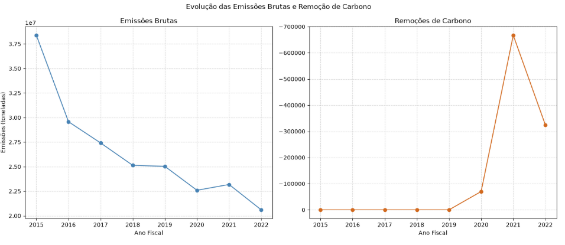
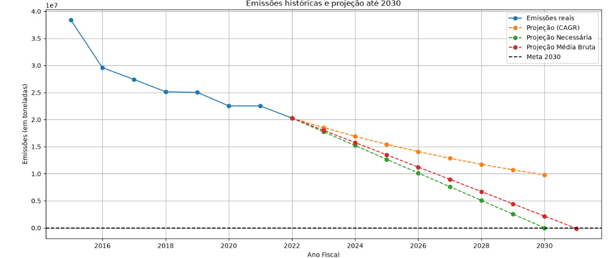
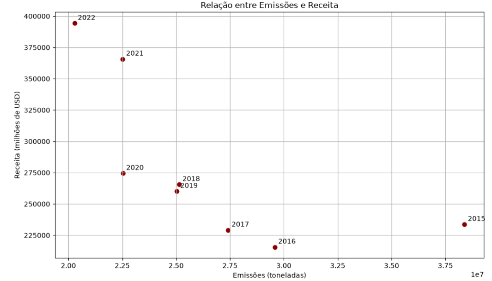

# Análise das Emissões de Gases de Efeito Estufa

> Ferramentas: MySQL, Python, Pandas, NumPy, Matplotlib.

O projeto investiga a evolução das emissões de gases de efeito estufa da Apple entre 2015 e 2022. A análise foi orientada por três perguntas de negócio:

**Perguntas de negócio**

1. As emissões diminuíram ao longo do período?
2. Mantido o ritmo histórico, a empresa estaria no caminho para atingir a meta de carbono zero até 2030?
3. Como as emissões evoluíram em relação à receita e ao valor de mercado?


## Etapa 1 - Preparação e exploração com MySQL

> O MySQL foi utilizado para conhecer a estrutura dos dados e verificar sua consistência antes da análise em Python.

Exemplos de consultas utilizadas:

**Verificação duplicatas**

```sql
SELECT *, COUNT(*) 
    FROM gas_emissions
    GROUP BY `Fiscal Year`, Category, `Type`, Scope, `Description`, Emissions
    HAVING COUNT(*) > 1;
```

**Agregação das emissões por ano**

```sql
SELECT
    `Fiscal Year`,
    SUM(Emissions) AS emissoes_anuais
FROM gas_emissions
GROUP BY `Fiscal Year`
ORDER BY `Fiscal Year`;
```
**Comparação das emissões e fatores de normalização**

```sql
SELECT nf.`Fiscal Year`, nf.Revenue, nf.`Market Capitalization`,
    SUM(ge.Emissions) AS total_emissoes
FROM normalizing_factors AS nf
INNER JOIN gas_emissions AS ge
    ON ge.`Fiscal Year` = nf.`Fiscal Year`
GROUP BY nf.`Fiscal Year`, nf.Revenue, nf.`Market Capitalization`
ORDER BY nf.`Fiscal Year` ASC;
```

Durante a validação, foram identificados registros sem classificação de escopo e valores negativos. A investigação das colunas `Type` e `Description` indicou que esses valores estavam associados a remoções de carbono, e não necessariamente a erros de registro. Essa verificação evitou tratar remoções como emissões brutas.

## Etapa 2 -  Análise com Python

> Após a exploração inicial, os dados foram analisados com Pandas, NumPy e Matplotlib. O agrupamento por ano permitiu calcular totais e variações percentuais.

**Exemplo — agregação anual**

```python
emissoes_anuais = (
    df.groupby("Fiscal Year")["Emissions"]
      .sum()
      .reset_index()
      .sort_values("Fiscal Year")
)

emissoes_anuais["var_pct"] = (
    emissoes_anuais["Emissions"].pct_change() * 100
)
```

**Exemplo — taxa composta de redução (CAGR)**

```python
taxa_anual = 1 - (
    (emissoes_2022 / emissoes_2015) ** (1 / 7)
)

print(f"{taxa_anual * 100:.2f}% a.a.")
```

A taxa composta foi utilizada para construir um cenário matemático de continuidade do ritmo histórico. Também foram comparados cenários de redução linear e o ritmo necessário para alcançar a meta até 2030.

## Etapa 3 - Visualizações

### Emissões brutas e remoções de carbono

```python
emissoes_brutas = df[df['Type'] == 'Gross emissions'].groupby('Fiscal Year')['Emissions'].sum().reset_index()
emissoes_brutas = emissoes_brutas.sort_values('Fiscal Year')

remocoes = df[df['Type'] == 'Carbon removals'].groupby('Fiscal Year')['Emissions'].sum().reset_index()
remocoes = remocoes.sort_values('Fiscal Year')


fig, (ax1, ax2) = plt.subplots(1, 2, figsize=(14, 6))

ax1.plot(emissoes_brutas['Fiscal Year'], emissoes_brutas['Emissions'], marker='o', label='Emissões Brutas', color='steelblue')
ax1.set_title('Emissões Brutas')
ax1.set_xlabel('Ano Fiscal')
ax1.set_ylabel('Emissões (toneladas)')
ax1.grid(True, linestyle='--', alpha=0.5)


ax2.plot(remocoes['Fiscal Year'], remocoes['Emissions'], marker='o', color='chocolate')
ax2.set_title('Remoções de Carbono')
ax2.set_xlabel('Ano Fiscal')
ax2.grid(True, linestyle='--', alpha=0.5)
ax2.invert_yaxis()

fig.suptitle('Evolução das Emissões Brutas e Remoção de Carbono')
plt.tight_layout()
plt.show()
```



A separação entre emissões brutas e remoções ajuda a evitar que os valores negativos ocultem comportamentos distintos na série.

### Cenários de projeção até 2030

```python

anos_reais = list(range(2015,2023))
anos_proj = list(range(2022,2031))
n_anos = 2030-2022
ano2031 = list(range(2022,2032))

#Emissões reais
emissoes_reais = list(emissoes_anuais['Emissions']) 

#Emissões projetadas com o CAGR
emissoes_proj = [emissoes_2022]

for i in range(8):
    proxe = emissoes_proj[-1] * (1 - taxa_anual)
    emissoes_proj.append(round(proxe, 2))

#Emissões projetadas Ideal
reducao_anual_ideal = emissoes_2022 / n_anos
emissoes_proj_ideal = [round(emissoes_2022 - (reducao_anual_ideal * i), 2) for i in range(n_anos + 1)]

#Emissões projetadas Média Produto Bruto
reducao_anual_bruto = (emissoes_2015-emissoes_2022)/n_anos
emissoes_proj_bruto = [round(emissoes_2022 - (reducao_anual_bruto * i), 2) for i in range(n_anos+2)] 


plt.figure(figsize=(13,6))

plt.plot(anos_reais, emissoes_reais, marker='o', label='Emissões reais')
plt.plot(anos_proj, emissoes_proj, marker='o', linestyle='--', label='Projeção (CAGR)')
plt.plot(anos_proj, emissoes_proj_ideal, marker='o', linestyle='--', label='Projeção Necessária')
plt.plot(ano2031, emissoes_proj_bruto, marker='o', linestyle='--', label='Projeção Média Bruta')


plt.axhline(0, linestyle='--',label='Meta 2030', color='black')

plt.title('Emissões históricas e projeção até 2030')
plt.xlabel('Ano Fiscal')
plt.ylabel('Emissões (em toneladas)')
plt.grid(True)
plt.legend()
plt.tight_layout()
plt.show()
```



Foram comparados o cenário baseado no CAGR histórico, uma trajetória linear de redução e a redução linear necessária para chegar a zero no horizonte considerado. São cenários ilustrativos, não previsões do desempenho real da empresa.

### Relação entre emissões e receita

```python
plt.figure(figsize=(10,6))

plt.scatter(emissoes_receita['emissions'], emissoes_receita['revenue'], color='darkred')

#Para indicar o ano
for _, linha in emissoes_receita.iterrows():
    plt.annotate(int(linha['ano']), (linha['emissions'], linha['revenue']),xytext=(5, 5), textcoords='offset points')

plt.title('Relação entre Emissões e Receita')
plt.xlabel('Emissões (toneladas)')
plt.ylabel('Receita (milhões de USD)')

plt.grid(True)
plt.tight_layout()
plt.show()
```



A análise explorou a relação entre as duas variáveis. A correlação calculada foi de aproximadamente **-0,68**. Como a série contém apenas oito observações anuais, esse resultado deve ser interpretado com cautela: correlação não demonstra causalidade.

## Etapa 4 - Principais observações

- A análise detalhada das emissões anuais apontou uma redução acumulada de aproximadamente **47,2% entre 2015 e 2022**.
- O ritmo histórico calculado pelo CAGR foi de aproximadamente **8,71% ao ano**.
- No cenário linear elaborado no notebook, a redução necessária no primeiro ano da projeção foi estimada em **12,5%**, acima do ritmo composto histórico.
- A receita apresentou crescimento composto médio calculado de aproximadamente **7,76%** no período.
- A comparação entre emissões e indicadores econômicos não permite afirmar que a redução das emissões causou ou não causou mudanças no desempenho financeiro. Seriam necessários mais dados e variáveis para uma conclusão causal.

## Ferramentas e competências aplicadas

- **MySQL / SQL:** consultas, agregações, validação e exploração de dados relacionais.
- **Python:** integração com banco de dados e análise programática.
- **Pandas:** manipulação, agrupamento e transformação de dados.
- **NumPy:** cálculos numéricos e apoio às projeções.
- **Matplotlib:** construção de gráficos para análise e comunicação dos resultados.
- **Estatística:** variação percentual, CAGR, projeções de cenários e correlação.

## Conclusão

O projeto percorreu um fluxo de análise desde a validação das bases até a interpretação dos indicadores. A combinação de SQL e Python permitiu explorar os dados sob diferentes perspectivas, construir visualizações e avaliar cenários relacionados às metas ambientais da Apple.

**Reprodutibilidade:** o notebook completo contém as consultas, etapas de análise e gráficos. Para executar a parte conectada ao MySQL, é necessário configurar o banco local e informar as próprias credenciais, sem compartilhá-las no repositório.
